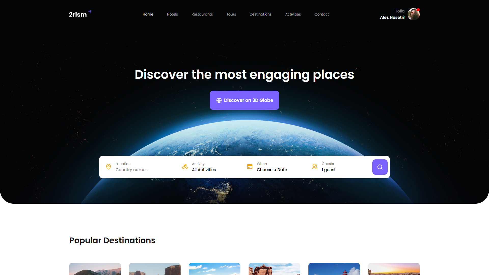
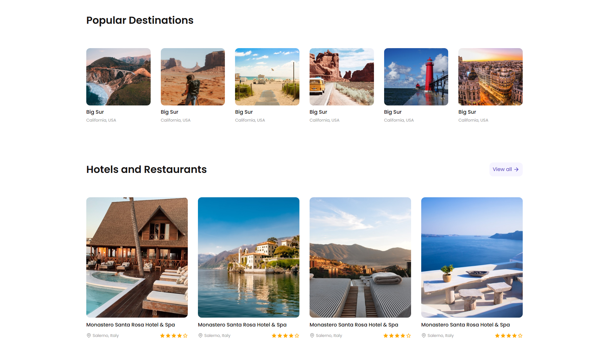
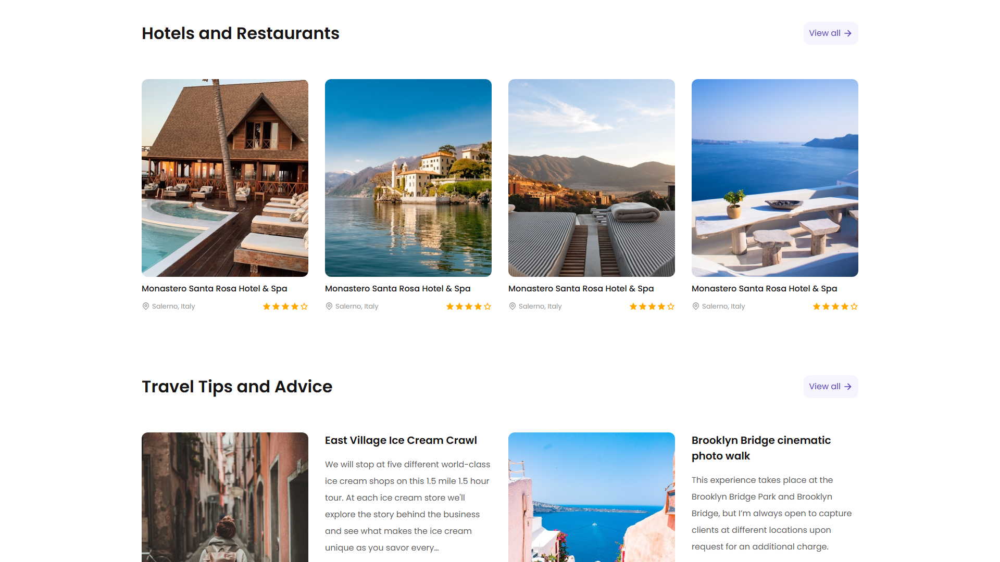
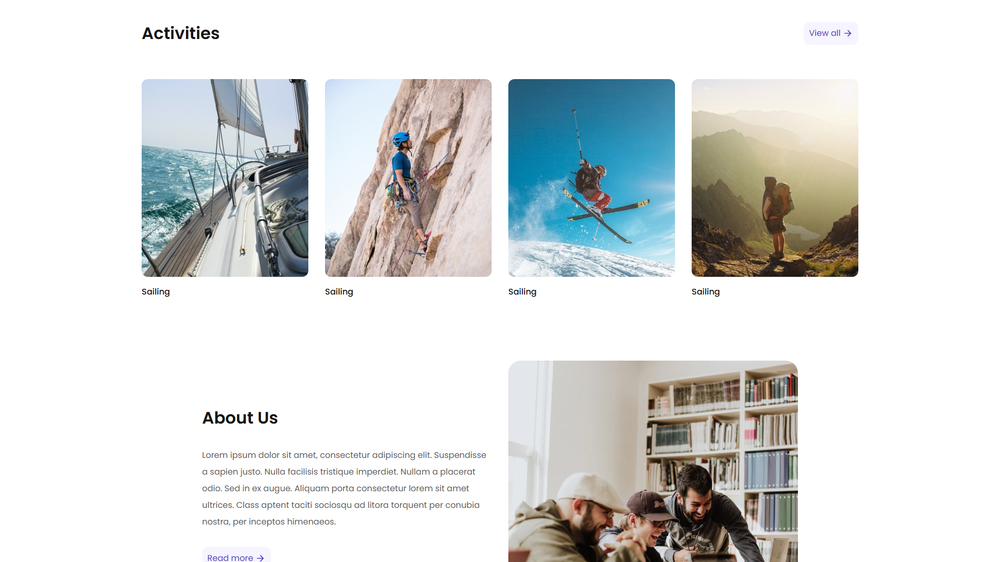
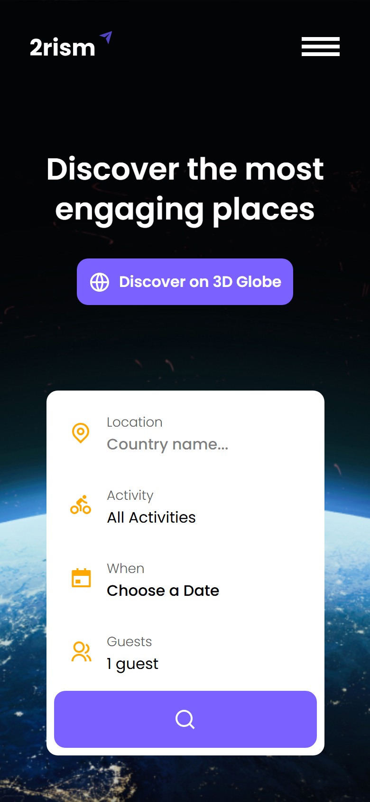

<p align="center">
  <picture>
    <source media="(prefers-color-scheme: dark)" srcset="img/logo/logo.svg">
    
  </picture>
</p>

<p align="center">
  <b>Лендинг туристического сервиса: поиск направлений, отели и рестораны, советы путешественникам и активности.</b>
</p>

<p align="center">
  
  
  
  <a href="https://dekciw.github.io/2rism/"></a>
</p>

<p align="center">
  <a href="https://dekciw.github.io/2rism/">
    
  </a>
</p>

<br>

<p align="center">
  
</p>

<br>

<table align="center">
  <tr>
    <th>&#8199;&#8199;&#8199;&#8199;&#8199;&#8199;Поиск поездки&#8199;&#8199;&#8199;&#8199;&#8199;&#8199;</th>
    <th>&#8199;&#8199;&#8199;&#8199;&#8199;&#8199;Разделы&#8199;&#8199;&#8199;&#8199;&#8199;&#8199;</th>
    <th>&#8199;&#8199;&#8199;&#8199;&#8199;&#8199;Вёрстка&#8199;&#8199;&#8199;&#8199;&#8199;&#8199;</th>
  </tr>
  <tr>
    <td valign="top">
      - Страна с подсказками<br>
      - Около 250 стран в списке<br>
      - Выбор активности<br>
      - Дата в календаре<br>
      - Количество гостей<br>
      - Кнопка поиска
    </td>
    <td valign="top">
      - Популярные направления<br>
      - Отели и рестораны<br>
      - Советы путешественникам<br>
      - Активности<br>
      - О нас<br>
      - Подписка на рассылку
    </td>
    <td valign="top">
      - Адаптив до телефона<br>
      - Мобильное меню<br>
      - Карточки с рейтингом<br>
      - HTML, CSS и JavaScript<br>
      - Без сборки и фреймворков<br>
      - Сайт на GitHub Pages
    </td>
  </tr>
</table>

<h3 align="center">Как это выглядит</h3>

<table align="center">
  <tr>
    <td width="50%" align="center" valign="top">
      <br>
      <sub>Популярные направления</sub>
    </td>
    <td width="50%" align="center" valign="top">
      <br>
      <sub>Отели и советы путешественникам</sub>
    </td>
  </tr>
  <tr>
    <td width="50%" align="center" valign="top">
      <br>
      <sub>Активности и раздел «О нас»</sub>
    </td>
    <td width="50%" align="center" valign="top">
      <br>
      <sub>Мобильная версия</sub>
    </td>
  </tr>
</table>

<br>

<details>
<summary><b>Подробнее о проекте: структура, библиотеки, запуск</b> (нажми, чтобы развернуть)</summary>

<br>

### Структура

```
.
├── index.html          # вся страница: шапка, поиск, разделы, подвал
├── css/                # стили: основа, кнопки, мобильное меню, адаптив
├── js/
│   ├── input-dest.js   # список стран и подсказки в поле «Location»
│   ├── main.js         # выпадающие списки, календарь, поле подписки
│   └── mobile-nav.js   # открытие и закрытие мобильного меню
├── libs/               # сторонние библиотеки
├── img/                # фотографии, логотипы и иконки
├── icons/              # SVG-иконки интерфейса
└── assets/             # скриншоты для README
```

### Библиотеки

<p>
- <b>autoComplete.js:</b> подсказки при вводе страны<br>
- <b>custom-select:</b> оформленные выпадающие списки активности и гостей<br>
- <b>easepick:</b> календарь для выбора даты
</p>

### Запуск

Сборка и зависимости не нужны: откройте `index.html` в браузере. Стили календаря подгружаются из CDN, поэтому для него нужен интернет.

</details>

